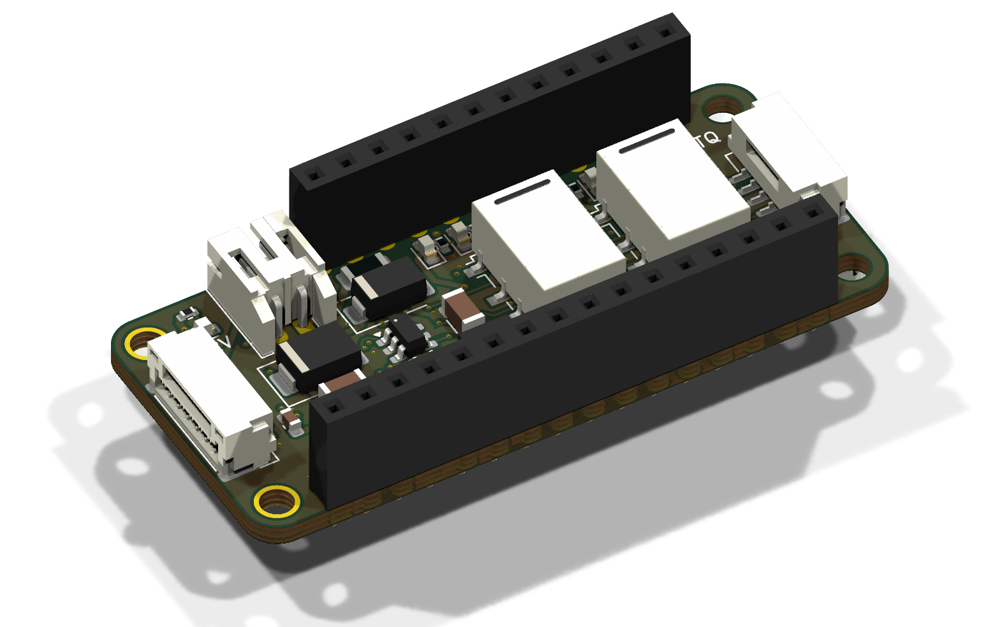

# Bench stimulus FeatherWing

A FeatherWing for the EPS logger stack that does four jobs:

1. **Powers the whole stack from 12 V** (bench supply or the car battery), so the logger needs no USB power bank.
2. **Powers the Toyota steering-angle sensor** (12 V, ~30 mA, switched and fused) and passes its CAN on to the Feather M4 CAN.
3. **Drives the EPS signals** NEP (rpm) and VSP (speed) and, with the wheels off the ground, VT3/VT6 (fake driver torque).
4. **Switches IG1** for an EPS that's out of the car, on a bench.

It sits **between the Adalogger and the OLED FeatherWing**, on stacking headers, and every cable connector is right-angle and exits a board edge. The brief is [HANDOFF.md](HANDOFF.md).

> **Status: routed and checked in KiCad 10.0.8, nothing ordered.** The board is fully routed, and the Gerbers, BOM and CPL are in [fab/](fab/). Read [Before ordering](#before-ordering) first: several part numbers, the relay pinout and the JLC rotations still need a human check.
>
> | KiCad 10.0.8 check (with JLCPCB's rules, [bench_stim_wing.kicad_dru](bench_stim_wing.kicad_dru)) | Result |
> |---|---|
> | ERC | **0 errors**. 20 warnings: symbols drawn from KiCad 7's library differ from KiCad 10's copies, and KiCad 10 renamed `G6K-2` |
> | DRC | **0 copper errors, 0 unconnected, 0 schematic-parity issues**, including JLCPCB's 0.2 mm track-to-through-hole-pad rule and 1.0 mm / 0.15 mm text. Warnings left: stock footprint outlines touching their own pads (JLC clips those), footprints differ from KiCad 10's library copies, and J2's outline at the board edge (deliberate, edge connector) |

| Top (3D) | Back (3D) |
|---|---|
|  |  |



**Every part has a 3D model**, and the models ship with the project in [bench_stim_wing.3dshapes/](bench_stim_wing.3dshapes/). They're STEP files from KiCad's official library, referenced as `${KIPRJMOD}/bench_stim_wing.3dshapes/...`, so the 3D viewer and STEP export work on any machine with KiCad 7 to 10, whatever 3D libraries are installed. J1 shows the Feather stacking headers' female sockets (1×16 + 1×12). Only the test pads and the JP1 solder jumper have no model, because they're bare copper.

| Top layers | Back layers (seen from below) |
|---|---|
|  |  |

## Safety model

The user asked for this to be overbuilt. **Faking VT3/VT6 makes the EPS motor steer by itself**: front wheels off the ground (or the rack on a bench rig), hands clear of the wheel.

| Layer | What it does |
|---|---|
| **Relays, fail to the car** | Every EPS line (VT3, VT6, NEP, VSP) goes through an Omron G6K relay. The **NC** contact connects the EPS to the car's own wire, and the **NO** contact connects it to this board. No power, a reset, a crash or a blown fuse all leave the EPS wired exactly as the car wires it. |
| **ARM loop (hard kill)** | Both relay coils and the IG1 output are powered only through the **ARM loop on J5 pins 7–8**. Wire a normally-closed e-stop or a key switch there. **Loop open = car wiring, whatever the firmware does.** The red ARM LED shows the loop is closed. |
| **Enable bits** | Each output also needs its own bit from the TCA9534 I2C expander. The expander powers up with every pin as an input, and 100 kΩ pull-downs hold every driver off until firmware sets the bit. |
| **Clamped torque range** | The DAC uses its 2.048 V internal reference and the op-amp gain is 2.2, so the torque outputs top out at **4.5 V** even at full scale. They're also clamped to 0–5 V, with a 470 Ω series resistor each. |
| **Inject on the EPS side only** | NEP and VSP also feed the gauges, ECM, MCM, TCM and climate control. Only ever break them at the EPS with a breakout harness: the relay then isolates the EPS from the car wire, and the car side never sees the stimulus. |

**Latching DTCs.** The torque-sensor and sensor-supply codes (11/15/16/17/18/67) latch until erased with the SCS procedure, so a bad VT3/VT6 fake bricks assist until you clear them. The relay swaps only VT3/VT6: the real sensor stays connected to Vcc1/Vcc2 and stays powered, so the supply checks still see a real load.

**Plausibility rules** (from the manual, also in [EPS_PINOUT.md](../data_capture/EPS_PINOUT.md)):
- Never send speed without rpm. At ≥ 6.2 mph with ≤ 280 rpm for 3 s, the lamp comes on with DTC 22.
- Ramp speed changes, because VSS jumps also set DTC 22.
- Don't hold ≥ 2,000 rpm at ≤ 1 mph for more than 6 minutes.

**Key ON, engine off: the 12 V battery isn't being charged.** The DC-DC converter doesn't charge it in that state (LiBCM FAQ), so all assist current comes from the battery. Keep bench sessions short, or put a charger on the battery.

## Stack and mechanics

```
  OLED FeatherWing
  ─ female side of this wing's stacking headers ─
  BENCH STIM WING        top: relays, inductor, J2/J3/J4, LEDs   (tallest part: relays, 5.2 mm)
                         back: logic, test pads, J5              (back parts <= 1.25 mm, J5 4.25 mm)
  ─ long male tails into the Adalogger's female headers ─
  Adalogger FeatherWing  (CR1220 holder and microSD socket on its top: ~2-4 mm)
  Feather M4 CAN         (USB-C at the left end, CAN terminal block at the right end)
  EPS tap wing           (bottom wing, connectors facing down)
```

Why this slot:
- **Feather ↔ Adalogger was ruled out.** The Feather M4 CAN's 3.5 mm CAN terminal block (right end) and USB-C (left end) sit right where this board's back and its edge connectors would be.
- **The Adalogger's top is low.** The tallest parts there are the CR1220 holder (x ≈ 3–17 mm) and the microSD socket (x ≈ 27–40 mm). That's why every back-side part on this wing is ≤ 1.25 mm tall, and J5 sits at the right end, where the Adalogger is bare.
- **The OLED's underside is bare,** so the relays (5.2 mm), the inductor (3 mm) and the 4.25 mm GH connectors fit under it, inside the ~8.5 mm stacking-header gap.

Use **Feather stacking headers** (female on top, long male tails) on this wing. **Check the gap with the real parts before soldering the headers.**

### Grounding, and running with the logger

This wing and the [EPS tap wing](../data_capture/hardware/eps_tap_wing/README.md) logger run **alone or together, in the car or on a bench EPS**. [STACK_MODES.md](../data_capture/STACK_MODES.md) covers every combination: power, ground, which pins to wire, and the timers and I2C addresses they share.

**The one rule:** J2's ground (the stack's ground) goes to the **ECU end of A4 (PG, BLK)**, spliced within ~10 cm of the EPS connector. On a bench, it goes to the EPS's A4 terminal. It must not go to a chassis bolt or the battery. A4 carries the 40 A motor return, so anywhere else puts an offset between the stack and the EPS's sensor ground (B9).
- **Logger accuracy:** that offset would shift every logger reading.
- **Faked torque:** it would also shift the VT3/VT6 values this board produces.

**Leave J4.3 and J5.4 (GND) unwired in the car,** so there's only one ground path. Fitted but unpowered (J2 unplugged), this board is passive: the relays rest on the car's wiring, and the logger keeps floating on its power bank.

### Feather specification check

| Spec item | This wing |
|---|---|
| 0.9" × 2.0", 0.1" holes at each corner | 22.86 × 50.8 mm, four 2.5 mm holes 2.54 mm in from the edges |
| 16-pin and 12-pin header positions | Same footprint as the EPS tap wing; `make_pcb.py` asserts the pad positions every build |
| Power: take 3.3 V from the Feather | The expander and DAC run on the Feather's 3V3 (about 1 mA) |
| Powering the Feather from a wing | 5 V goes into the **USB pin through a Schottky** (D6). On the Feather M4 CAN the USB pin is VBUS straight off the USB-C connector, and the Feather's own MBR540 then feeds its regulator, so this is the normal path (checked against Adafruit's schematic) |
| Avoid AREF, RX/TX, SPI and its CS | AREF, RX and SPI are untouched. **TX is used** (VSP output): only D4 and RX/TX are left free in this stack, and NEP and VSP each need their own timer |
| I2C pull-ups on Wings | Not fitted: the Adalogger already has them |

### USB and 12 V at the same time

- **Our side:** the buck makes 5.05 V. After D6's drop the Feather's USB pin sees about **4.7 V**.
- **With a PC plugged in:** the PC's 5 V is higher, so the PC carries the stack and D6 stays off. This board never back-feeds the PC.
- **With 12 V gone:** D6 also stops the USB cable from powering this board's 5 V rail. The relays and op-amp go dead, and so the EPS is on the car wiring.

**A LiPo on the Feather.** If one is plugged into the Feather's JST, its charger draws up to ~200 mA from this 5 V rail. The buck is rated 0.6 A, so that still fits, but leave the LiPo off unless you want it charging.

**The current clamp's supply.** The HSTS016L on the tap wing takes its 5 V from the USB pin, so on 12 V alone it gets ~4.7 V. Its output is read as Vout − Vref, which cancels most of that offset, but **check its zero at key-on** the first time.

## Connectors

All connectors are right-angle and exit a board edge. **JLC assembles the three GH connectors** (J3, J4, J5: SMD, 1.25 mm pitch, awkward by hand). J2 (through-hole PH) and the Feather stacking headers are hand-soldered. The GH parts have locking latches: use JST GH housings (GHR-0xV-S) with SSHL-002T-P0.2 contacts, or buy pre-crimped GH leads.

**J2, 12 V IN** (top edge, JST PH S2B-PH-K, 2 mm). Pin 1 (marked +) is +12 V and pin 2 is GND. 2 A fuse.

**J3, SAS / CAN** (left end, JST GH 6-way). This is a pass-through: build one cable to the SAS, plus one pair from pins 5/6 to the Feather's CAN terminal.

| Pin | Net | Goes to |
|---|---|---|
| 1 | SAS 12V | SAS power (switched, 0.1 A PTC) |
| 2 | GND | SAS ground |
| 3 | CANH | SAS CAN-H |
| 4 | CANL | SAS CAN-L |
| 5 | CANH | Feather M4 CAN terminal **pin 3 (H)** |
| 6 | CANL | Feather M4 CAN terminal **pin 1 (L)** |

The Feather's terminal has a 120 Ω terminator behind a solder jumper (SJ2). The SAS bus here is two nodes, so close SJ2 unless the SAS end already terminates the bus.

**Second microcontroller:** J3 is also the stack's port for another board. Splice its CAN-H/CAN-L into the pin 5/6 lead (no ground or power wire), keep exactly two terminators on the bus (about 60 Ω across H/L, powered off), and use IDs 0x6C0–0x6CF. See [AUX_LINK.md](../data_capture/AUX_LINK.md).

**J4, TORQUE** (right end, top, JST GH 5-way). Break the torque sensor's VT3 and VT6 wires in a breakout harness: the CAR side goes to the sensor, the EPS side to the EPS.

| Pin | Net |
|---|---|
| 1 | VT3 EPS side (gearbox 7-pin 3 / ECU B10) |
| 2 | VT3 sensor side |
| 3 | GND (leave unwired in the car: the reference comes through J2's ground, see below) |
| 4 | VT6 EPS side (gearbox 7-pin 1 / ECU B8) |
| 5 | VT6 sensor side |

**J5, ECM / IG1 / ARM** (right end, back, JST GH 8-way). The back silk marks "J5" with pins "1" and "8"; the pin names are below.

| Pin | Net | Notes |
|---|---|---|
| 1 | IG1 OUT | Switched 12 V, 0.5 A PTC. Bench EPS only (ECU B6) |
| 2 | NEP CAR | Car-side NEP wire (ECM) |
| 3 | NEP EPS | EPS B14 |
| 4 | GND | Separates the 12 V-level pins from the 5 V-level pins. Leave unwired in the car |
| 5 | VSP EPS | EPS B4 |
| 6 | VSP CAR | Car-side VSP wire (VSS) |
| 7 | ARM+ | 5 V out to the ARM loop (0.1 A PTC) |
| 8 | ARM | Back from the loop: powers the relay coils, enables IG1 |

**Loopback for free.** The tap wing's J2 reads NEP (D6), VSP (D5), VT3 (A2) and VT6 (A3). Tap the **EPS side** of the breakout harness and the logger records exactly what the EPS receives, including whether the relay switched.

## Circuit summary

| Block | Parts | Notes |
|---|---|---|
| 12 V input | F1 2 A fast fuse → D1 SS34 (reverse polarity) → D2 SMBJ24CA TVS → C1 10 µF/50 V | Everything on +12 V is rated ≥ 40 V; the TVS clamps a load dump to ~39 V |
| 5 V | U1 LMR16006 (40 V, 65 V transient, 0.6 A, 0.7 MHz), L1 22 µH, D4 catch diode, 56k/10k → 5.05 V | ~250 mA load: stack ~150 mA, relays 2 × 28 mA, LEDs |
| Feather feed | D6 PMEG6010 → Feather USB pin | See [USB and 12 V at the same time](#usb-and-12-v-at-the-same-time) |
| SAS power | Q1 Si2319 high side, Q2 2N7002, F2 0.1 A PTC | Expander P0. **JP1** (open as shipped): bridge for "SAS always on", for use with the unmodified logger firmware |
| IG1 out | Q3 Si2319, Q4 + Q5 in series (IG1_EN **and** ARM), F4 0.5 A PTC | Expander P1 |
| Relays | K1 (VT3/VT6), K2 (NEP/VSP): G6K-2F-Y 5 V, Q6/Q7 drivers, 1N4148WS flyback | Expander P2, P3. Coils fed from ARM |
| NEP | D4 (PA14) → Q8 → open drain, **4.7 kΩ to 12 V**, 100 Ω series | Like the ECM's open-collector output |
| VSP | TX (PB16) → Q9 → open drain, **4.7 kΩ to 5 V**, 100 Ω series | Like the VSS |
| Torque | U2 MCP4728 (I2C 0x60, 2.048 V ref, gain ×1) → U3 MCP6004 on 5 V, gain 2.2 → 470 Ω → BAT54S clamp | DAC A = VT3, B = VT6. DAC C and D go **straight** to test pads 10/11 as spare 0–2.048 V outputs (unbuffered, ~mA); op-amp sections C/D are parked as grounded followers |
| Expander | U4 TCA9534 (I2C **0x20**) | P0 SAS, P1 IG1, P2 K1, P3 K2 (outputs); P4 ARM sense, P5 12 V sense (inputs); P6/P7 on test pads |

**Pulse output polarity.** GPIO high pulls the output low (open drain), and the idle level is high. Both D4 and TX sit on independent timers: PA14 on TCC1/WO2 or TCC2/WO0, PB16 on TC6/WO0 or TCC0/WO4. **Don't use TC3**: the logger (`eps_logger`) uses it for its 1 kHz sample tick. The rates are low (NEP 1.5 pulses/rev: 22.5 Hz at 900 rpm; VSP ~1.24 Hz per mph, **unverified**), so plain `micros()` timing also works.

**I2C addresses** on the shared bus: RTC 0x68, OLED 0x3C, ADS1115 0x48, **MCP4728 0x60, TCA9534 0x20**. There are no clashes.

### LEDs

Top side, in one row above the relays. Left to right: **5V, SAS, IG1, ARM, TQ, SIG, NEP, VSP**; the legend is also on the back silk. The 12 V LED is in the top-left corner. TQ and SIG light when their relay is energised. NEP and VSP blink with the pulse outputs.

### Test pads (back)

The pads are numbered 1–15 on the back silk; names don't fit at JLC's 1 mm minimum text height.

| TP | Net | TP | Net | TP | Net |
|---|---|---|---|---|---|
| 1 | GND | 6 | NEP out | 11 | DAC D (raw, 0–2.048 V) |
| 2 | +12 V | 7 | VSP out | 12 | ARM |
| 3 | +5 V | 8 | VT3 out | 13 | Expander P6 |
| 4 | +3V3 | 9 | VT6 out | 14 | Expander P7 |
| 5 | USB pin | 10 | DAC C (raw, 0–2.048 V) | 15 | GND |

## Design rules

| Item | Value |
|---|---|
| Layers | 4: **F.Cu** parts + signals + GND pour, **In1.Cu** solid GND, **In2.Cu** signals + GND pour, **B.Cu** parts + signals + GND pour |
| Signal tracks | 0.15 mm (mA and below) |
| Power tracks | +12 V path and IG1 0.5 mm; +5 V, USB, buck SW, SAS and ARM 0.4 mm; 3V3 0.3 mm |
| Clearance | 0.127 mm; **0.21 mm from tracks to plated through-hole pads** (JLCPCB's 0.2 mm pad-to-trace rule) |
| GND plane | In1 is a solid GND pour; a few low-speed signals cross it where routing needed the room |
| Silkscreen | All text >= 1.0 mm high with a 0.15 mm stroke (JLCPCB minimum) |
| JLCPCB rules | [bench_stim_wing.kicad_dru](bench_stim_wing.kicad_dru), the 4-layer 1 oz set from [Cimos/kicad-druid](https://github.com/Cimos/kicad-druid) (MIT). KiCad loads it as the project's custom rules |
| Vias | 0.45/0.2 mm signal, 0.6/0.3 mm power |
| Assembly | **Both sides** (SMD top and back). The back carries only parts ≤ 1.25 mm tall |

## Files

| File | What it is |
|---|---|
| [bench_stim_wing.kicad_sch](bench_stim_wing.kicad_sch) / [schematic PDF](doc/bench_stim_wing_schematic.pdf) | Schematic (generated) |
| [bench_stim_wing.kicad_pcb](bench_stim_wing.kicad_pcb) | Board, 50.8 × 22.86 mm (FeatherWing), 4 layers |
| [doc/](doc/) | 3D renders (KiCad 10) and layer renders of the top and back |
| [bench_stim_wing.3dshapes/](bench_stim_wing.3dshapes/) | The 3D models every footprint points to (KiCad library STEP files, CC-BY-SA 4.0 with the KiCad library exception) |
| [fab/](fab/) | Gerbers + drill (zipped), JLC BOM and CPL. All SMD parts including the GH connectors; J1 (stacking headers), J2, JP1 and the test pads are excluded |
| [gen/](gen/) | Generators. Everything comes from [gen/design.py](gen/design.py) (parts and nets) and [gen/placement.py](gen/placement.py) (positions, silk, hand stubs). [gen/bench_stim_wing.ses](gen/bench_stim_wing.ses) is the accepted Freerouting result |

## Rebuilding

The board was generated in a Linux cloud session. The generators ran on **KiCad 7.0.11**, the version Ubuntu ships. Sign-off ran on **KiCad 10.0.8**, which [gen/setup_kicad10.sh](gen/setup_kicad10.sh) installs from the official `kicad/kicad` Docker image. That image comes through Google's Docker Hub mirror, because KiCad's Launchpad PPA is blocked there and Docker Hub rate-limits anonymous pulls. The script runs KiCad 10 through `chroot`, which needs root. Routing used **Freerouting 1.9.0** on Java 21, under `xvfb-run`. The files are written in KiCad 7's format. KiCad 10 opens them and asks to upgrade on save. Upgrading is fine, but then the generators would overwrite your edits, so pick one way of working.

```bash
cd gen
sh route.sh --keep-routing   # rebuild everything from the committed routing (bench_stim_wing.ses)
sh route.sh                  # full re-route with Freerouting (a different result every run)
```

`route.sh` expects `kicad-cli` and a Python that can `import pcbnew` (`PY=...`). A full re-route also needs the Freerouting 1.9 jar (`JAR=...`). On Windows with KiCad 10, point `PY` at KiCad's bundled `python.exe`, and set `KICAD_SYMBOL_DIR` / `KICAD_FOOTPRINT_DIR` if the libraries aren't found.

**How it got to 0 unconnected (and JLCPCB-clean):**
- **Freerouting version.** 2.0.1 ignored its pass limit and never finished, so routing uses 1.9.0 with `-oit 100`. Without that flag the post-route optimiser runs for hours.
- **Rules.** Signal tracks are 0.15 mm with 0.127 mm clearance, but tracks stay **0.21 mm from plated through-hole pads**, per JLCPCB's 0.2 mm pad-to-trace rule. KiCad 7 doesn't export per-pad clearances to Freerouting, so `make_pcb.py` grows the through-hole pads in the router's copy of the board instead (`dsn_router_tweaks`).
- **Spare DAC channels simplified.** DAC C/D used to have their own op-amp stages. Routing those with the wider through-hole clearance left nets unroutable, so they now go straight to test pads 10/11.
- **Hand fixes** ([placement.py](gen/placement.py) `MANUAL_ROUTES`, which belongs to the committed [bench_stim_wing.ses](gen/bench_stim_wing.ses)). KiCad 7 exports some back-side pads to Freerouting on the wrong layer, which leaves a few connections "connected" in its eyes but open on the board. [maze_route.py](gen/maze_route.py) (a small 4-layer grid router that keeps every clearance) and [find_via.py](gen/find_via.py) close them:
  - **Q5 gate:** routed to the ARM net, 0.15 mm (gate drive only).
  - **R2's +12V pad:** gets a via up to the +12V track. **That via is in the pad.** It's fine for a 100 k pull-up, but ask JLC to plug/tent vias. To make room, an In2 +5V run moves down.
  - A NEP_DRV detour that Freerouting threaded through R27's pad gap is replaced with a direct drop.
- **Net classes live in [bench_stim_wing.kicad_pro](bench_stim_wing.kicad_pro),** so KiCad 10 opens the board with the same rules.
- **In1 (the GND plane) carries a few signal tracks.** A signal-free In1 was tried, but with the wider through-hole clearances it left ~35 connections unroutable. The slots this cuts in the plane are harmless at these speeds.

`check_netlist.py` checks every pin in the exported netlist against `design.py`. When `kicad10-cli` is installed, `route.sh` also runs KiCad 10's ERC, its DRC with schematic parity, and the 3D renders.

## Before ordering

1. **ERC and DRC already pass in KiCad 10.0.8** (see Status). Open the board in your own KiCad 10 once anyway. If you save it there, KiCad upgrades the file and the generators would overwrite your edits.
2. **Check the relay pinout** against Omron's G6K datasheet: coil 1/8, COM 3/6, NC 2/7, NO 4/5. That pinout came from KiCad's G6K-2 symbol. If NC and NO are swapped, the board fails the wrong way.
3. **Check stock on the LCSC numbers.** Every part in the BOM now has an LCSC number, each matched to its listing in November 2026 (see [JLCPCB parts](#jlcpcb-parts)). Stock moves, so re-check at upload. Use the listed alternatives if a part has run out.
4. **Check every CPL rotation** in JLC's preview, on both sides. The CPL already applies the community rotation corrections (see [Ordering at JLCPCB](#ordering-at-jlcpcb)), but JLC's preview is the final word. Watch especially the diodes, LEDs, SOT-23s, the relays and the GH connectors, since a polarity error there matters.
5. **Check the stack gap** with the real stacking headers, relays and the OLED.
6. **Confirm LMR16006's FB voltage (0.765 V)** against the datasheet. The output is 5.05 V with 56k/10k.

## Ordering at JLCPCB

1. **PCB:** upload [fab/bench_stim_wing_gerbers.zip](fab/bench_stim_wing_gerbers.zip). 4 layers, 1.6 mm, 50.8 × 22.86 mm; the defaults are fine (the board follows JLC's 4-layer 1 oz rules in [bench_stim_wing.kicad_dru](bench_stim_wing.kicad_dru)).
2. **Assembly:** turn on PCB Assembly, **both sides** (parts sit on top and back), Standard PCBA.
3. Upload [fab/bench_stim_wing_bom_jlc.csv](fab/bench_stim_wing_bom_jlc.csv) and [fab/bench_stim_wing_cpl_jlc.csv](fab/bench_stim_wing_cpl_jlc.csv). The column names match JLC's templates, so no remapping is needed.
4. Check stock and the placement preview, part by part (see [Before ordering](#before-ordering)).
5. Hand-solder J1 (Feather stacking headers, Adafruit PID 2830) and J2 (JST PH S2B-PH-K) afterwards.

How the CPL is made ([gen/export_fab.py](gen/export_fab.py)), the same way Bouni's [kicad-jlcpcb-tools](https://github.com/Bouni/kicad-jlcpcb-tools) plugin does it:

- **Position:** the centre of each footprint's copper pads, measured from the board's bottom-left corner (the drill/aux origin), Y up.
- **Rotation:** bottom-side angles are mirrored (180° − angle), then JLC's library offset is added per footprint, from the community database the plugin uses ([JLCKicadTools](https://github.com/matthewlai/JLCKicadTools) `cpl_rotations_db.csv`):

| Footprint | Correction |
|---|---|
| SOT-23, SOT-23-6 | −90° |
| TSSOP-14/16, MSOP-10 | 270° (MSOP-10 isn't listed; it's the same package as VSSOP-10) |
| Omron G6K-2F-Y relay | 270° |
| JST GH (and PH) | 180° |

**Other tools:** the schematic symbols carry `MPN` and `LCSC` fields, which is what the kicad-jlcpcb-tools plugin and JLC's own KiCad workflow read. Opening the project with that plugin should therefore pick up every part number. All footprints and symbols use KiCad's standard library names (`Resistor_SMD:R_0402_1005Metric` and so on), plus the project's own `bench_stim_wing` libraries for the Feather headers and JP1, through `${KIPRJMOD}` library tables.

## Hand assembly: DigiKey parts

[fab/bench_stim_wing_bom_digikey_x2.csv](fab/bench_stim_wing_bom_digikey_x2.csv) lists everything for **two bare boards**, with spares (passives rounded up to DigiKey's 10-piece breaks), plus optional JST mating housings and contacts. Upload it to DigiKey's BOM Manager, which matches by manufacturer part number. It's the same circuit as the JLC BOM, with DigiKey-stocked parts in place of the LCSC-only ones:

| Refs | JLC part | DigiKey part | Check |
|---|---|---|---|
| LEDs | Hubei KENTO KT-0603x | Lite-On LTST-C191K(G/S/R)KT, LTST-C191TBKT | Same 0603 footprint. Lite-On marks the cathode differently: check before soldering |
| D1 | MDD SS34 | Vishay SS34-E3/57T | |
| L1 | Sunlord SWPA4030S220MT | Abracon ASPI-4030S-220M-T | 4 × 4 mm, Isat 1.3 A. Check its pads against the footprint |
| D4, D6 | Nexperia PMEG6010CEH | Rohm RB160MM-60TR (SOD-123FL) | 60 V 1 A, fits the SOD-123F pads. Cathode band = pad 1 |
| Q1, Q3 | Vishay Si2319CDS | Vishay SQ2319ADS-T1_GE3 | Same −40 V P-FET, automotive grade, same SOT-23 pinout |
| D16, D17 | Nexperia BAT54S | onsemi BAT54SLT1G | Same series pinout |
| Caps (1206, 0805, 0402) | Samsung | Murata GRM equivalents | Same value, voltage and dielectric |
| J5 | JST SM08B-GHS-TB | same, from Mouser or LCSC | DigiKey out of stock until January 2027 |
| Mating leads | loose crimp contacts | JST pre-crimped jumpers AGHGH28K152 (GH), ASPHSPH24K152 (PH) | Loose contacts are sold only by the reel. Cut each jumper in half: two leads |
| F4 | LUTE 1206L050/30NR (30 V) | Littelfuse 1206L050/24WR (24 V) | No 30 V 0.5 A 1206 PTC found at DigiKey. Fine at 12 V; load-dump spikes above 24 V are the TVS's job |
| Resistors | UNI-ROYAL | YAGEO RC0402FR-07… / RC0603FR-07… | |
| 2N7002 | generic | onsemi 2N7002LT1G | |

Building by hand: solder the back first (it has the fine-pitch ICs and only low parts), then the top, relays last. JP1, the test pads and TP labels need nothing.

## JLCPCB parts

All 38 line items have LCSC numbers in [fab/bench_stim_wing_bom_jlc.csv](fab/bench_stim_wing_bom_jlc.csv).

| Part | LCSC | Notes |
|---|---|---|
| LMR16006YQDDCRQ1 buck | C544521 | Extended. TI rates it **40 V, 65 V transient**. The TVS clamps at ~39 V |
| MCP4728-E/UN DAC | C108207 | Extended |
| MCP6004T-I/ST op-amp | C50282 | Extended. Microchip, tape & reel. Replaced C185811 (tube version: only 3 in stock at JLC). Fallback: UMW MCP6004T-I/ST, C32713110 |
| TCA9534PWR expander | C783615 | Extended |
| Si2319CDS-T1-GE3 P-FET | C146287 | Vishay. Avoid the "-JSM" copy, C18191323, which has a different rating |
| G6K-2F-Y DC5 relay | C231389 | In stock. C1560486 is the same MPN but listed unavailable |
| SWPA4030S220MT 22 µH | C83472 | Isat 1.3 A |
| SMBJ24CA TVS | C1973089 | Bourns. Every SMBJ24CA listing found is Extended |
| PMEG6010CEH-QX Schottky | C5311567 | Extended. AEC-Q101 version of PMEG6010CEH, same SOD-123F part. Replaced C110797 (no stock at JLC) |
| SS34 Schottky | C8678 | Basic, but marked "not recommended for new designs"; alternative is FOSAN C5119706 |
| BAT54S | C171786 | |
| JST GH headers, SM05B / SM06B / SM08B-GHS-TB(LF)(SN) | C189896 / C133065 / C265111 | Extended. J4 / J3 / J5. C133065 showed 0 stock on one LCSC page |
| 2 A fuse, 1206 | C3105 | Littelfuse 0466002.NRHF, the halogen-free version of 0466002.NR |
| 0.1 A PTC, 60 V | C2153714 | Littelfuse 1206L010/60WR |
| 0.5 A PTC, 30 V | C7542947 | LUTE 1206L050/30NR. No LCSC listing found for the Littelfuse 1206L050/30WR |
| 10 µF 50 V 1206 | C13585 | |
| 4.7 µF 50 V 1206 | C51205 | |
| 10 µF 25 V 0805 | C15850 | Basic |
| 100 nF 50 V 0603 | C14663 | Basic. Showed out of stock on one LCSC page |
| 0402 resistors (100R, 470R, 1k, 10k, 12k, 22k, 33k, 100k) | C25076, C25117, C11702, C25744, C25752, C25768, C25779, C25741 | UNI-ROYAL, Basic |
| 56k 0402 | C25796 | UNI-ROYAL. **Extended**, not Basic |
| 4.7k 0603 | C23162 | Basic |
| 2N7002 | C8545 | Basic |
| 1N4148WS | C2128 | Basic |
| LEDs 0603, Hubei KENTO: red KT-0603R, yellow KT-0603Y, blue KT-0603B, green KT-0603G | C2286, C2287, C2288, C12624 | Red is Basic; the others are Extended. Replaced the Everlight C72038/C72041/C72043, which JLC had no stock of |

**About 19 Extended part types,** at about $3 each in setup fees. Swapping R3 56k for a Basic value would mean recomputing the 5 V divider. Not worth it.

## Firmware (next)

Nothing is written yet. A bench sketch (or a bench mode in `eps_logger`) needs:
- Serial commands for rpm and mph. The OLED buttons share D5/D6/D9 with the tap wing inputs, so they can't be used.
- Ramp limits and the plausibility guards: rpm ≥ ~800 whenever speed > 0, and a time limit on high rpm at zero speed.
- The expander set up as P0–P3 outputs (low), then P4/P5 read as inputs.
- **Refuse to energise K1 unless ARM reads closed**, and drop K1 on any serial timeout.
- Logging of what was commanded, next to what the tap wing measured.

`eps_logger/config.h` says D4 is the CAN boost enable. Adafruit's Feather M4 CAN schematic shows boost enable and CAN standby are internal pins PB13 and PB12, and D4 (PA14) only goes to the header. Fix that comment when the firmware is touched.
